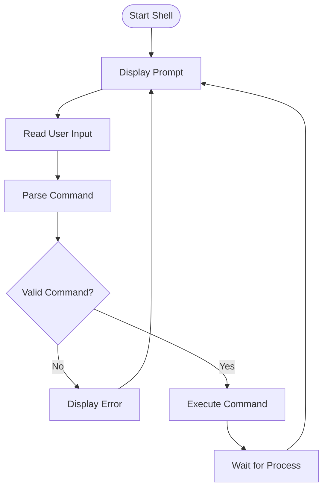

# 🐚 Shell — Building a Shell from Scratch in C

<p align="center">
  
  
  
  
</p>

<p align="center">
  <b>A lightweight command-line shell implemented from scratch in C.</b>
  <br/>
  Exploring how shells read commands, process input, and interact with the operating system.
</p>

---

## 📖 Introduction

A shell is a command-line interpreter that provides an interface between users and the operating system.

This project aims to build a simple shell using the C programming language while understanding the fundamental concepts behind command-line interfaces and process management.

Rather than relying on an existing shell implementation, this project focuses on learning how the underlying mechanisms work by implementing them step by step.

## 🎯 Project Objectives

- Understand how command-line interpreters work internally.
- Learn how programs interact with the operating system.
- Explore process creation and execution.
- Understand input parsing and command handling.
- Practice memory management in C.
- Develop practical systems programming skills.

## ✨ Features

The shell is currently under development.

Planned functionality includes:

- [ ] Interactive command-line prompt.
- [ ] Read and process user input.
- [ ] Parse commands and arguments.
- [ ] Execute external programs.
- [ ] Handle built-in commands.
- [ ] Implement command history.
- [ ] Support input and output redirection.
- [ ] Support pipelines.
- [ ] Handle background processes.
- [ ] Improve error handling.

Features will be marked complete as they are implemented and tested.

## 🏗️ How a Shell Works

A basic shell follows a command-processing cycle:



## 🛠️ Technologies Used

| Technology | Purpose |
|---|---|
| C | Core programming language |
| GCC | C compiler |
| Git | Version control |
| GitHub | Source code hosting |
| VS Code | Development environment |

## 📂 Project Structure

```text
Shell/
├── .vscode/
│   ├── c_cpp_properties.json
│   ├── launch.json
│   └── settings.json
├── shell.c
├── .gitignore
└── README.md
```

## ⚙️ Getting Started

### Prerequisites

- GCC compiler
- Git
- VS Code (optional)

Check your compiler:

```bash
gcc --version
```

### Clone the Repository

```bash
git clone https://github.com/Suraj-12343423/Shell.git
```

### Navigate to the Project

```bash
cd Shell
```

### Compile

```bash
gcc shell.c -o my_shell
```

### Run

On Linux:

```bash
./my_shell
```

On Windows PowerShell:

```powershell
.\my_shell.exe
```

*Note: The build and execution instructions will be finalized after confirming the platform and implementation compatibility.*

## 🧠 Core Concepts I'm Exploring

| Concept | What I'm learning |
|---|---|
| Input handling | Reading commands from the terminal |
| String processing | Tokenizing command input |
| Pointers | Working with memory and strings |
| Dynamic memory | Managing allocated memory |
| Processes | Creating and managing processes |
| System calls | Interacting with the operating system |
| Error handling | Handling invalid commands and failures |

## 🗺️ Development Roadmap

- [x] Initialize the repository.
- [x] Set up the C development environment.
- [x] Implement the initial shell foundation.
- [ ] Improve command parsing.
- [ ] Add built-in commands.
- [ ] Implement process management.
- [ ] Add redirection.
- [ ] Implement pipes.
- [ ] Add background execution.
- [ ] Improve testing and documentation.

## 🧪 Testing

Testing will cover:

- Valid commands.
- Invalid commands.
- Empty input.
- Commands with multiple arguments.
- Memory allocation failures.
- Process execution errors.

## 📚 Learning Resources

- [Write a Shell in C — Stephen Brennan](https://brennan.io/2015/01/16/write-a-shell-in-c/)
- [GNU C Library Documentation](https://www.gnu.org/software/libc/manual/)
- [Linux man-pages](https://man7.org/linux/man-pages/)
- [The Linux Programming Interface](https://man7.org/tlpi/)

## 🤝 Contributions

This is primarily a learning project, and suggestions, bug reports, and constructive feedback are welcome.

If you find an issue, feel free to open a GitHub issue.

## 👨‍💻 Author

**Sai Suraj**

- GitHub: [@Suraj-12343423](https://github.com/Suraj-12343423)

## 📜 License

This project is currently a learning project. Licensing will be added once the license choice is finalized.

---

<p align="center">
  <b>Learning systems programming, one command at a time. ⚙️</b>
</p>
