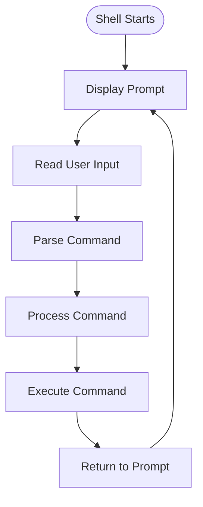

# 🐚 Shell — A Command-Line Shell in C

<p align="center">
  
  
  
  
</p>

<p align="center">
  <b>A lightweight command-line interpreter written in C.</b>
  <br/>
  Understanding how shells interact with the operating system.
</p>

---

## 📖 Overview

A shell is a command-line interpreter that acts as an interface between users and the operating system.

**Shell** is a C programming project focused on understanding the fundamentals of command-line interpreters, command processing, and operating-system interaction.

The project explores low-level programming concepts through practical implementation using the C language.

## ✨ Key Concepts

- 🖥️ Command-line interfaces
- ⚙️ Process creation and execution
- 🔍 Command parsing and tokenization
- 🧠 Memory management
- 📂 File and directory operations
- 🔗 Operating-system interaction
- 🛠️ Error handling

## 🏗️ Shell Architecture



## 📂 Project Structure

```text
Shell/
│
├── .vscode/
│   ├── c_cpp_properties.json
│   ├── launch.json
│   └── settings.json
│
├── shell.c
├── .gitignore
└── README.md
```

## 🛠️ Tech Stack

| Technology | Usage |
|---|---|
| C | Core implementation |
| GCC | Compilation |
| Git | Version control |
| GitHub | Repository hosting |
| VS Code | Code editor |

## ⚙️ Installation

### Prerequisites

- GCC compiler
- Git
- Linux environment

### 1. Clone the repository

```bash
git clone https://github.com/Suraj-12343423/Shell.git
```

### 2. Navigate to the project

```bash
cd Shell
```

### 3. Compile the source code

```bash
gcc shell.c -o my_shell
```

### 4. Run the shell

```bash
./my_shell
```

## 🧠 Concepts Behind the Project

| Concept | Description |
|---|---|
| Processes | Understanding program execution |
| System Calls | Communication with the operating system |
| Pointers | Memory address manipulation |
| Strings | Command input processing |
| Dynamic Memory | Runtime memory allocation |
| Parsing | Breaking input into meaningful components |

## 📚 References

- [Write a Shell in C — Stephen Brennan](https://brennan.io/2015/01/16/write-a-shell-in-c/)
- [GNU C Library](https://www.gnu.org/software/libc/manual/)
- [Linux Manual Pages](https://man7.org/linux/man-pages/)

## 👨‍💻 Author

**Sai Suraj**

[](https://github.com/Suraj-12343423)

---

<p align="center">
  <b>Built with C. Inspired by how operating systems work. ⚙️</b>
</p>
